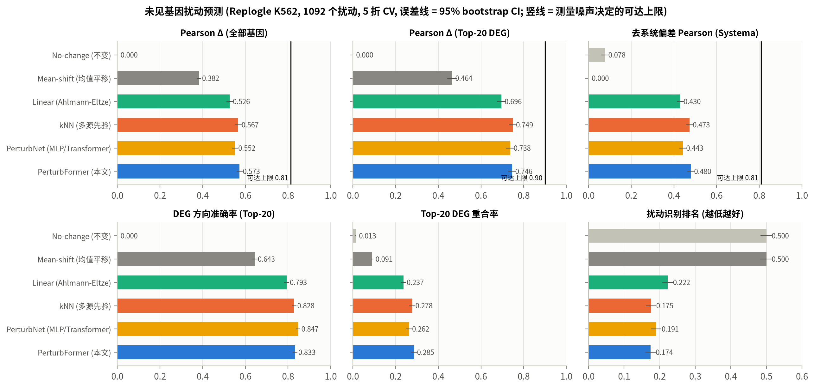
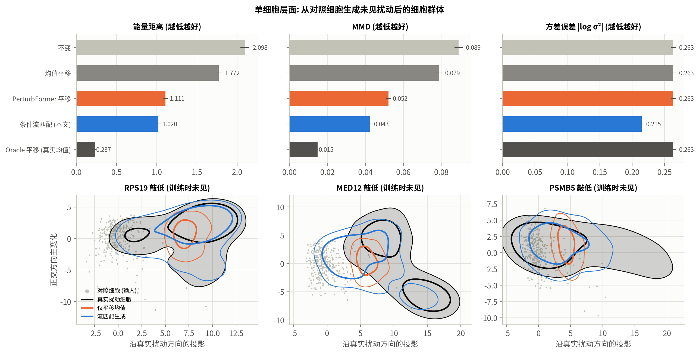
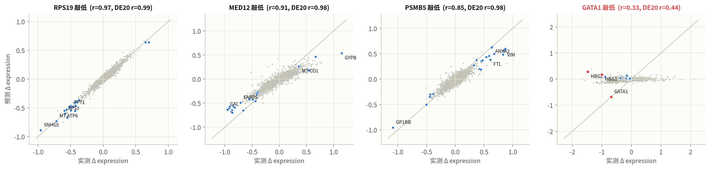
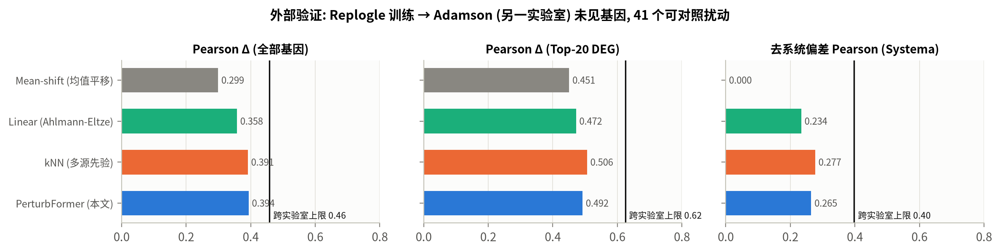

# VirtualCell-Perturb

**虚拟细胞扰动预测：敲低一个从未做过实验的基因，细胞会怎样变化？**

生物医学信息学课程设计 · 选题九（吉林大学人工智能学院）

> 输入"细胞 + 基因扰动"，输出预测的扰动后细胞状态。
> 监督版本 **PerturbFormer**（在已测扰动上做知识核交叉注意力的检索增强 Transformer）预测平均表达变化与 DEG 方向；
> 高级版本 **条件流匹配**（Conditional Flow Matching）把预测展开为每个细胞的反事实状态。

## 主要结果

**评测设定**：Replogle 2022 K562 必需基因 CRISPRi 筛选，按基因做 5 折交叉验证，1,092 个基因每个都作为**训练时完全未见**的基因被预测一次。超参数只在开发集上选择，测试折从未参与调参。

| 模型 | Pearson Δ 全部基因 | Pearson Δ Top-20 DEG | 去偏 Pearson (Systema) | DEG 方向准确率 | 识别排名 ↓ |
|---|---|---|---|---|---|
| Mean-shift（均值平移） | 0.382 | 0.464 | 0.000 | 0.643 | 0.500 |
| Linear（Ahlmann-Eltze 2025）+KD | 0.526 | 0.696 | 0.430 | 0.793 | 0.222 |
| PerturbNet（Transformer + MLP）+KD | 0.552 | 0.738 | 0.443 | **0.847** | 0.191 |
| kNN 多源先验 +KD | 0.567 | **0.749** | 0.473 | 0.828 | 0.175 |
| **PerturbFormer +KD（本文）** | **0.573** | 0.746 | **0.480** | 0.833 | **0.174** |
| *测量噪声决定的可达上限* | 0.813 | 0.900 | 0.808 | — | — |

- 均值平移的全基因相关看似不差，但**去偏 Pearson 为 0**：它不含任何扰动特异信息。
- PerturbFormer 在全部 7 项指标上显著优于线性基线（配对 Wilcoxon p < 1e-21）；相对多源 kNN 小幅但显著领先（6 项中 4 优、1 平、1 劣）。核心收益来自**多源知识检索**这一思路。
- 消融：去掉 GO（−0.029）、GenePT 语言模型嵌入（−0.024）、知识核注意力（−0.021）、STRING PPI（−0.020）都会显著下降；CRISPRi 敲低规则使 Top-20 DEG 相关提升 0.072。
- **单细胞（条件流匹配）**：相对只平移均值，能量距离 −8%、方差误差 −19%（p < 1e-38）；能复现敲低后的细胞异质性。
- **第二个数据集**（Adamson 2016，86 个扰动，同样的未见基因评测）：PerturbFormer 在所有指标上最优，去偏 Pearson 0.544（kNN 0.498，线性 0.476）。
- **跨实验室外部验证**（Replogle → Adamson，全部为未见基因）：达到"直接重测同一基因"上限的 79–86%。
- **生物学解释**：预测保留 CORUM 复合体与 Hallmark 通路结构（通路相关 r = 0.59）；核糖体、蛋白酶体、Mediator 等复合体成员最可预测；GATA1 这类谱系特异的主调控因子是明确的失败边界。

| | |
|---|---|
|  |  |
|  |  |

完整报告：[`docs/report.md`](docs/report.md) · 汇报 PPT：`docs/VirtualCell-Perturb_汇报.pptx` · 交互式浏览器：`docs/explorer.html`（浏览器直接打开）


## 项目结构

```
VirtualCell-Perturb/
├── run_all.sh                    # 一键复现全部结果（CPU，4 核约 2.5 小时）
├── requirements.txt
├── src/vcp/                      # Python 包
│   ├── data.py                   # Perturb-seq 读取、分块伪批量统计、Welch t / BH-FDR、划分
│   ├── embeddings.py             # 扰动编码：GO / STRING PPI / 应答谱（GenePT 在 02 脚本）
│   ├── baselines.py              # No-change、Mean-shift、Linear (Ahlmann-Eltze 2025)、kNN、KD 规则
│   ├── models.py                 # PerturbNet、PerturbFormer、KernelPerturbFormer（主模型）
│   ├── flow.py                   # 条件流匹配（OT-CFM）单细胞生成器
│   ├── metrics.py                # Pearson Δ、DEG 方向、Systema 去偏、识别排名、能量距离、MMD
│   ├── interpret.py              # 基因集、功能分类、富集分析、通路得分
│   ├── predictor.py              # VirtualCell 用户 API
│   ├── pipeline.py               # 数据 + 先验的统一加载
│   └── plotting.py               # 统一绘图风格（经色盲校验的调色板）
├── scripts/
│   ├── 00_download_data.sh       # 下载全部公开数据
│   ├── 01_preprocess.py          # 伪批量统计 + 单细胞 PCA 潜空间
│   ├── 02_build_embeddings.py    # 先验知识嵌入（扰动基因 + 全基因组约 2.1 万基因）
│   ├── 03_benchmark.py           # 5 折未见扰动评测（全部模型 + 消融）
│   ├── 03b_dev_sweep.py          # 仅在开发集上的超参数扫描
│   ├── 04_noise_ceiling.py       # 细胞拆半噪声天花板
│   ├── 05_flow.py                # 条件流匹配训练与单细胞评测
│   ├── 06_external_validation.py # Replogle → Adamson 跨实验室验证
│   ├── 07_interpretation.py      # 生物学解释
│   ├── 08_train_final.py         # 用全部扰动训练可部署模型
│   ├── 09_figures.py             # 评测图表与统计检验
│   ├── 10_export_explorer.py     # 交互式网页
│   └── predict.py                # 命令行：细胞 + 基因 → 扰动后状态
├── results/                      # 指标表（csv / md）
├── figures/                      # 全部图
└── docs/                         # 报告、汇报 PPT、交互式浏览器
```

## 快速开始

```bash
python -m venv .venv && source .venv/bin/activate
pip install torch --index-url https://download.pytorch.org/whl/cpu
pip install -r requirements.txt
bash run_all.sh            # 或按 run_all.sh 中的顺序逐步运行
```

单独使用训练好的虚拟细胞：

```bash
python scripts/predict.py --gene GATA1                         # 300 个 K562 对照细胞，GATA1 视为未见基因
python scripts/predict.py --gene MED12 --cells my_cells.h5ad   # 自己的细胞（log 归一化表达）
python scripts/predict.py --gene TP53                          # 筛选中从未扰动过的任意基因
```

```python
from vcp.predictor import VirtualCell
vc = VirtualCell.load("models/k562", gmt="data/raw/genesets/MSigDB_Hallmark_2020.gmt")
out = vc.predict("GATA1", cells=X_ctrl)   # X_ctrl: (n, 5000) 对照细胞
out["cells"]        # (n, 5000) 这些细胞被敲低后的预测表达
out["delta"]        # (5000,)   伪批量变化
out["neighbors"]    # 预测所依据的已测扰动及注意力权重
print(vc.report(out))
```

## 数据

| 数据集 | 内容 | 用途 |
|---|---|---|
| Replogle et al., *Cell* 2022 — K562 essential | CRISPRi，1,092 个基因敲低，162,751 细胞 × 5,000 基因 | 训练与 5 折未见基因评测 |
| Adamson et al., *Cell* 2016 — UPR | CRISPRi，86 个基因敲低，68,603 细胞 | 跨实验室外部验证 |
| Gene Ontology（GEARS gene2go） | 基因功能注释 | 扰动编码 |
| STRING v12 | 人类蛋白互作网络 | 扰动编码 |
| GenePT（Chen & Zou 2024） | GPT 嵌入的 NCBI 基因摘要 | 扰动编码（语言模型先验） |
| MSigDB Hallmark、GO BP、CORUM | 基因集与蛋白复合体 | 生物学解释 |

所有数据由 `scripts/00_download_data.sh` 从公开来源下载（Harvard Dataverse、STRING、Zenodo、Enrichr）。

## 参考文献
- Replogle J.M. et al. Mapping information-rich genotype-phenotype landscapes with genome-scale Perturb-seq. *Cell* 2022.
- Adamson B. et al. A multiplexed single-cell CRISPR screening platform enables systematic dissection of the unfolded protein response. *Cell* 2016.
- Roohani Y., Huang K., Leskovec J. Predicting transcriptional outcomes of novel multigene perturbations with GEARS. *Nat Biotechnol* 2024.
- Ahlmann-Eltze C., Huber W., Anders S. Deep-learning-based gene perturbation effect prediction does not yet outperform simple linear baselines. *Nat Methods* 2025.
- Viñas Torné R. et al. Systema: a framework for evaluating genetic perturbation response prediction beyond systematic variation. *Nat Biotechnol* 2025.
- Lipman Y. et al. Flow matching for generative modeling. *ICLR* 2023; Tong A. et al. Improving and generalizing flow-based generative models with minibatch optimal transport. *TMLR* 2024.
- Chen Y., Zou J. GenePT: a simple but effective foundation model for genes and cells built from ChatGPT. *bioRxiv* 2024.
- Peidli S. et al. scPerturb: harmonized single-cell perturbation data. *Nat Methods* 2024.
- Bunne C. et al. How to build the virtual cell with artificial intelligence: priorities and opportunities. *Cell* 2024.
