# 虚拟细胞扰动预测：预测基因敲除/敲低后的细胞响应
### 生物医学信息学课程设计 · 选题九

---

## 摘要

**问题**：如果敲低一个从未做过实验的基因，细胞的转录组会如何变化？
**数据**：Replogle 2022 K562 必需基因 CRISPRi Perturb-seq（1,092 个基因敲低，162,751 个细胞），Adamson 2016（另一实验室，86 个敲低）作外部验证；GO、STRING、GenePT（大语言模型基因嵌入）作为先验知识。
**模型**：提出 **PerturbFormer**，一种在"已测扰动记忆库"上做**知识核交叉注意力**的检索增强 Transformer：用多源先验知识找到功能相似且已经测过的基因，组合它们的真实响应，并加入 CRISPRi 敲低规则与 DEG 方向多任务损失；在此基础上用**条件流匹配（OT-CFM）**把预测展开为每个细胞的反事实状态，实现"输入细胞 + 基因扰动 → 输出扰动后细胞状态"。
**评测**：在 5 折未见基因交叉验证（1,092 个基因都作为未见基因被预测一次）中，PerturbFormer 的去系统偏差 Pearson 达到 0.480（测量噪声可达上限的 59%），在全部指标上显著优于 Ahlmann-Eltze 线性基线（基线经同等调参后仍然如此，去偏 Pearson +0.027），去偏 Pearson 比标准深度模型 PerturbNet 高 0.037（但 PerturbNet 的 DEG 方向准确率更高）。与同等调参后的多源 kNN 相比，两者在相关性指标上持平，PerturbFormer 在 DEG 方向、DEG 重合和扰动识别上稳定更好（3 种随机划分 × 6 项指标中 15 次显著更好、2 次更差）。在全部约 67 万个显著 DEG 上，上下调方向准确率为 87.8%。流匹配相对仅平移均值，使单细胞能量距离下降 7%、方差误差下降 17%（p < 1e-30；潜空间每折只用训练细胞构建），但与免训练的“借用相似扰动细胞”基线持平，其独有价值是逐细胞的反事实映射。已发表方法 GEARS 在相同的未见基因上明显更差；即使把预算提高到 30/50 细胞、20 epoch 重跑，GEARS+KD 的去偏 Pearson 仍只有 0.227/0.231（PerturbFormer 0.504），说明这不是欠训练造成的（单折、单数据子集）。跨实验室验证中，对未见基因的预测达到"直接重测同一基因"上限的 79–86%。
**解释**：预测保留了 CORUM 复合体与 Hallmark 通路结构（通路相关 r = 0.59）；每个预测都可追溯到注意力最高的已测扰动；核糖体、蛋白酶体、Mediator 等复合体成员最可预测，而 GATA1 这类谱系特异的主调控因子是明确的失败边界。

## 1 Problem：问题定义与价值

**核心问题**：如果敲低（knock down）某个基因，细胞的转录组会发生什么变化？能否对**从未做过实验的基因**给出可靠预测？

**为什么重要**
- 人类约 2 万个蛋白编码基因，两两组合约 2 亿种，再乘以细胞类型和剂量，实验无法穷举。Perturb-seq 单次实验成本高，一个全基因组筛选需要数十万到数百万个细胞。
- "虚拟细胞（virtual cell）"被认为是 AI 驱动生物学的核心目标之一（Bunne et al., *Cell* 2024；CZI、Arc Institute 的 Virtual Cell Challenge 2025）：在计算机中先筛选，再把实验预算花在最有希望的扰动上。
- 应用：靶点发现（预测敲低某靶点后是否逆转疾病表达谱）、遗传相互作用、毒性/脱靶预警、实验设计优化。

**形式化**：给定对照细胞状态 $x_0$ 与扰动基因 $g$，预测
1. 伪批量（pseudobulk）层面：平均表达变化 $\Delta_g = \mathbb{E}[x \mid g] - \mathbb{E}[x \mid \text{ctrl}] \in \mathbb{R}^{G}$；
2. 单细胞层面：扰动后细胞的分布 $p(x \mid g)$，以及**每个对照细胞的反事实状态** $x_0 \mapsto x_1$；
3. 每个差异表达基因（DEG）的方向（上调/下调）。

**关键难点（本项目明确针对）**
- **未见扰动泛化**：测试基因在训练时从未被扰动过，模型不能"记住"答案，只能依靠先验知识迁移。
- **系统性偏差陷阱**：近期研究（Ahlmann-Eltze et al., *Nat Methods* 2025；Viñas Torné et al., *Nat Biotech* 2025）发现，许多深度模型并不优于"所有扰动的平均效应"这一平凡基线——因为大多数扰动共享一个系统性的"受扰动"状态。必须用能剔除系统偏差的指标来评估。
- **技术噪声**：单个扰动只有几十到几百个细胞，测量本身就有噪声，需要估计"天花板"。

## 2 Data：数据

| 数据集 | 来源 | 细胞系 / 技术 | 规模 | 用途 |
|---|---|---|---|---|
| Replogle 2022 K562 essential | Replogle et al., *Cell* 2022 | K562，CRISPRi 敲低 | 162,751 细胞 × 5,000 HVG；**1,092 个基因扰动** + 10,691 对照细胞 | 主数据集：训练与 5 折未见扰动评测 |
| Adamson 2016 UPR | Adamson et al., *Cell* 2016 | K562，CRISPRi 敲低 | 68,603 细胞 × 5,060 基因；86 个扰动 + 24,263 对照 | 外部验证（另一实验室） + 数据集内评测 |

两个数据集均使用 GEARS（Roohani et al., *Nat Biotech* 2024）发布的预处理版本（log-normalized，Harvard Dataverse），保证与文献可比。

**敲低与敲除。** 题目问的是"敲除一个基因"。公开的大规模 Perturb-seq 数据（包括这里的两个）多用 CRISPRi：dCas9-KRAB 结合在启动子附近抑制转录，并不切断 DNA，因此严格说是"敲低"。在 412 个靶基因本身被测量的扰动中，靶基因 100% 显著下调，表达中位数降到接近 0（见 6.1），转录层面的效果接近敲除。本项目用它来回答题目的问题，同时在全文统一使用"敲低"一词。CRISPR 敲除（Cas9 切割）可能有更彻底或不同的效应（例如通过无义介导的降解、截短蛋白），这一差别是本项目的局限之一。

**先验知识（用于把"基因"编码成向量）**

| 来源 | 内容 | 覆盖率（1,137 个扰动基因） |
|---|---|---|
| Gene Ontology | 基因的 BP/CC/MF 注释（GEARS gene2go） | 99.6% |
| STRING v12 | 人类蛋白互作网络（combined score ≥ 700） | 97.6% |
| GenePT | 用 GPT-3.5 嵌入 NCBI 基因功能摘要（Chen & Zou 2024），即"生物医学语言模型"表示 | 99.5% |
| 应答谱（数据驱动） | 被扰动基因自身在训练扰动中的表达响应模式（仅当该基因被测量） | 37.7% |

**解释用数据**：MSigDB Hallmark、GO BP 2023、KEGG、Reactome、CORUM 蛋白复合体（Enrichr 基因集库）。

**预处理**（`scripts/01_preprocess.py`）
- 按扰动聚合得到伪批量均值/方差（分块稀疏矩阵运算，峰值内存 3.8 GB）；
- 每个扰动相对对照做 Welch t 检验 + BH 校正，得到 DEG；Top-20 DEG 按 |t| 排序；
- 单细胞：在分层抽样细胞上拟合 100 维 PCA，所有细胞投影到该潜空间（流模型用）。**评测时 PCA 在每一折中只用对照细胞和训练扰动的细胞重新拟合**，测试扰动不参与坐标系的构建（见 5.4）。

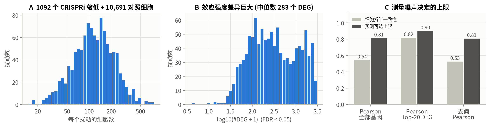
*图 1 数据概况：每个扰动的细胞数、差异基因数与测量噪声上限*

### 2.1 细胞与扰动的表征（control / perturbed cell representation）

`scripts/11_representation.py`，图 `figures/fig_repr.png`：

- **单细胞状态**：在 100 维 PCA 潜空间中，三类复合体基因敲低后的细胞平均偏离对照细胞 0.73–0.87 个对照标准差，且不同复合体偏离的方向不同（UMAP 上形成各自的区域）。同时有相当一部分扰动细胞与对照细胞重叠，说明敲低效果在细胞之间并不均一（可能来自 sgRNA 效率差异或细胞周期状态）。单细胞层面的这种异质性正是只预测平均值的模型无法表达、而生成模型（5.4）要刻画的内容。
- **扰动应答谱**：把 1,092 个扰动的伪批量响应 Δ 作为扰动的表征，核糖体、蛋白酶体、Mediator 三类复合体基因的 10 个最近邻中同类比例为 78%（随机打乱类别后 5%）。功能相同的基因敲低后响应相似，这是"借鉴相似的已测基因"能够成立的生物学基础。
- **潜空间是否够用**：100 维 PCA 只解释约 15.5% 的单细胞总方差，其余主要是单细胞测序的采样噪声；但对每一折未参与拟合的扰动，其平均响应 Δ 有 61%（训练扰动 62%） 落在这个潜空间内（中位数），与训练扰动相当。也就是说，潜空间保留了扰动效应的主要部分，并能推广到未见扰动。

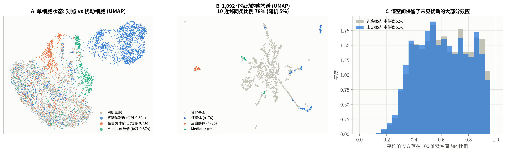
*图 2 细胞与扰动的表征*

## 3 Model：模型

### 3.1 扰动编码（Perturbation encoding）
把"敲低基因 g"表示为 4 个知识 token：GO（TF-IDF + SVD，128 维）、PPI（STRING 扩散谱嵌入 $P+P^2$，128 维）、GenePT（PCA 128 维）、应答谱（训练响应矩阵 SVD，64 维，**每折只用训练扰动计算**，无信息泄露）。缺失的知识源用可学习的"缺失 token"代替。

### 3.2 基线（必须打败的对手）
| 基线 | 说明 |
|---|---|
| No-change | 预测扰动无影响 |
| Mean-shift | 预测为所有训练扰动的平均变化（文献中最强的平凡基线） |
| Linear | $\Delta \approx b + G W p$，Ahlmann-Eltze et al. 2025 提出的线性基线（G 为训练响应主成分，p 为扰动嵌入） |
| kNN | 在先验知识空间中找最相似的 10 个已测基因，相似度加权平均其响应 |
| PerturbNet | 知识 token → Transformer 融合 → MLP 解码（标准监督深度模型） |

### 3.3 PerturbFormer（本文主模型，监督版本）
**思想**：预测一个未见基因的效应 ≈ "注意"那些在生物学上与它相似、且已经测过的基因。

$$\hat\Delta_i = \sum_h g_h(i)\,\mathrm{softmax}_j\!\Big(\tfrac{1}{\tau_h}\,\frac{\sum_s w_{hs}(i)\, m_s(i) m_s(j)\cos(A_s e_s(i), A_s e_s(j))}{\sum_s w_{hs}(i)\,m_s(i)m_s(j)}\Big)_{\text{top-}k}\Delta_j \;+\; g_0(i)\,\big(\mu + \mathrm{dec}(h_i)B^\top\big)$$

- **Query** = 待预测基因的知识 token（经 Transformer 编码器融合得到 $h_i$）；**Key** = 已测基因的知识 token；**Value** = 已测基因的真实响应 $\Delta_j$。
- **知识核注意力**：注意力 logits 由每个知识源的余弦相似度构成；$A_s$ 初始化为单位阵，所以初始模型正好等价于多源 kNN，训练只需学习"偏差修正"，在只有约 870 个训练扰动的情况下避免过拟合。
- **查询相关的知识源权重** $w_{hs}(i)$：模型自己决定对这个基因更该相信 GO、PPI、语言模型还是数据驱动的先验——可解释。
- **top-k 稀疏注意力**（k = 20）与多头（不同温度）。
- **参数化分支**：均值 + 训练响应低秩基底，经门控与检索分支混合。
- **CRISPRi 敲低规则（KD）**：被靶向基因本身的表达按训练集中位残余比例下调（领域知识先验）。
- **多任务损失**：DE 加权 MSE + DEG 方向的 logistic 损失（表达变化预测 + DEG 方向预测）；训练时随机丢弃知识源（source dropout），增强对缺失先验的鲁棒性。
- 训练：AdamW，早停（训练扰动内部 10% 作为验证），3 个随机种子集成。

### 3.4 条件流匹配（高级版本：生成模型）
目标：输入"**细胞 + 基因扰动**"，输出**这个细胞**扰动后的状态，并生成整个扰动后细胞群体。

- 在 100 维 PCA 潜空间中学习速度场 $v_\theta(x_t, t, c)$，通过 ODE 把对照细胞分布连续地输运到扰动后细胞分布（Lipman et al. 2023；Tong et al. 2024 OT-CFM）。
- 训练配对：每个扰动内部用 mini-batch **最优传输**（匈牙利算法）配对对照细胞与扰动细胞；$x_t = (1-t)x_0 + t x_1 + \sigma\epsilon$，回归 $u = x_1 - x_0$。
- **条件** $c$ = PerturbFormer 预测的伪批量变化在 PCA 上的投影。训练扰动使用"**排除自身的检索预测**"作为条件，使训练与测试时的条件分布一致（无标签泄露）。
- 网络：FiLM 调制的残差 MLP（时间 + 条件嵌入），中点法 20 步积分。
- 解码：PCA 子空间内的分布来自流模型；PCA 正交补上的均值（如靶基因自身的敲低）由 PerturbFormer 补回。

## 4 Benchmark：评测设计
- **5 折未见扰动交叉验证**：按扰动基因划分，每折 20% 的基因完全不出现在训练中；每个扰动恰好得到一次 out-of-fold 预测（全部 1,092 个用于生物学解释）。
- **开发集与测试集分离**：PerturbFormer 的设计与超参数只在开发集上比较（第 0 折训练扰动中划出的 87 个基因，`03b_dev_sweep.py`），线性和 kNN 基线在同一开发集上调参（`03d_baseline_tuning.py`）。开发集基因在其他四折中是测试基因，因此严格说只有第 0 折的 219 个测试基因从未参与任何设计选择；第 8 节单独报告了这一折。
- **指标**（每个扰动计算后取平均）
  - Pearson Δ（全部基因 / Top-20 DEG）、Top-20 DEG MSE（GEARS 标准）；
  - **DEG 方向准确率**（Top-20 / Top-100 显著 DEG 的上下调方向）；
  - **去系统偏差 Pearson（Systema）**：减去训练扰动平均响应后再算相关，Mean-shift 恒为 0，只奖励"扰动特异"的信号；
  - Top-20 DEG 重合率；
  - **扰动识别排名**：用预测去匹配所有真实扰动，真实扰动的归一化排名（0 = 完美，0.5 = 随机）；
  - 单细胞：能量距离（scPerturb E-distance）、RBF-MMD、方差误差。
- **噪声天花板**：把每个扰动和对照细胞随机拆成两半，用一半预测另一半。
- **统计检验**：配对 Wilcoxon 符号秩检验 + 95% bootstrap 置信区间；按效应强度分层。
- **划分稳健性**：五折划分用 3 个不同随机种子重复（主要模型），检查结论是否依赖某一种划分。
- **消融**：逐一去掉每个知识源、方向损失、KD 规则、Transformer 融合、知识核注意力、top-k 稀疏。
- **外部验证**：Replogle 训练（剔除所有 Adamson 靶基因）→ 预测 Adamson；以"同一基因在 Replogle 的实测响应"作为跨实验室可重复性上限。

## 5 Benchmark：结果

### 5.1 主结果（1,092 个未见基因，5 折 out-of-fold）

| 模型 | Pearson Δ 全部基因 | Pearson Δ Top-20 DEG | 去偏 Pearson (Systema) | DEG 方向准确率 | Top-20 DEG 重合率 | 识别排名 ↓ |
|---|---|---|---|---|---|---|
| No-change | 0.000 | 0.000 | 0.078 | 0.000 | 0.013 | 0.500 |
| Mean-shift（均值平移） | 0.382 | 0.464 | 0.000 | 0.643 | 0.091 | 0.500 |
| Linear（Ahlmann-Eltze 2025）+KD | 0.526 | 0.696 | 0.430 | 0.793 | 0.237 | 0.222 |
| PerturbNet（Transformer 融合 + MLP）+KD | 0.552 | 0.738 | 0.443 | **0.847** | 0.262 | 0.191 |
| kNN 多源先验 +KD | 0.567 | **0.749** | 0.473 | 0.828 | 0.278 | 0.175 |
| **PerturbFormer +KD（本文）** | **0.573** | 0.746 | **0.480** | 0.833 | **0.285** | **0.174** |
| *细胞拆半一致性（参考）* | 0.544 | 0.817 | 0.526 | 0.806 | 0.270 | 0.038 |
| *测量噪声决定的可达上限* | 0.813 | 0.900 | 0.808 | — | — | — |

（完整表格、95% bootstrap 置信区间与配对检验见 `results/replogle_k562_essential/main_table.md`、`stats_tests.csv`；图见 `figures/fig2_benchmark.png`。）

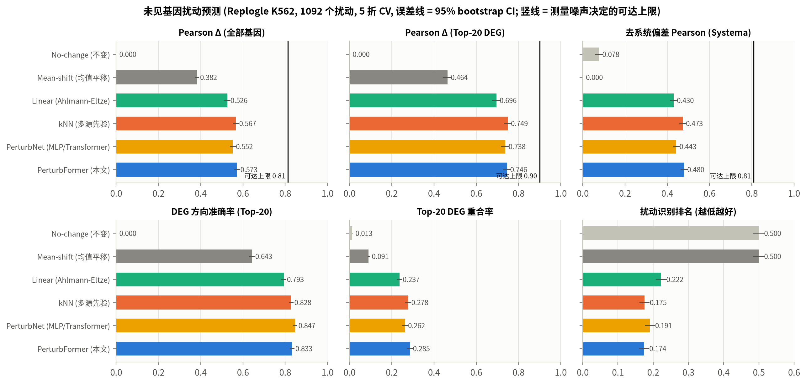
*图 3 未见基因扰动预测的主结果（误差线为 95% bootstrap CI）*

**结论 1：均值平移这一"平凡基线"看似不差，实则没有任何扰动特异信息。** 它的全基因 Pearson 达到 0.38，DEG 方向准确率 0.64，但去偏 Pearson 恰好为 0、识别排名为随机水平 0.5。这验证了 Systema 等工作的观点：如果只看传统相关性指标，会高估模型。

**结论 2：多源知识检索明显优于文献中的强基线。** PerturbFormer 相对（未调参的）线性基线，在全部 7 项指标上都显著更好（配对 Wilcoxon p < 1e-21；对调参后的线性基线见 5.1c）：去偏 Pearson +0.049，Top-20 DEG Pearson +0.050，方向准确率 +0.040，识别排名 0.222 → 0.174。相对标准深度模型 PerturbNet，去偏 Pearson +0.037（p = 2e-31）。

**结论 3：可学习的 PerturbFormer 只比精心设计的多源 kNN 小幅领先。** 5.1b 换 3 种划分验证了领先的稳定性；5.1c 给 kNN 同等调参后，两者在相关性指标上持平，PerturbFormer 的稳定优势集中在 DEG 方向、DEG 重合和扰动识别上。 在全基因 Pearson（+0.006，p = 3e-16）、去偏 Pearson（+0.006，p = 4e-8）、方向准确率（+0.005，p = 0.03）、DEG 重合率（+0.008，p = 0.007）和 Top-20 MSE（p = 3e-6）上显著更好；在 Top-20 DEG Pearson 上略差（−0.003，p = 0.004）；识别排名无显著差异。真正起决定作用的是"用多种先验知识找相似的已测基因"这一思路，PerturbFormer 的价值在于稳定的小幅增益与可解释性（知识源权重、检索邻居）。

**结论 4：如实说明一项劣势。** PerturbNet 的 DEG 方向准确率最高（0.847 vs 0.833）。一个可能的原因是：检索式模型的输出是多个已测响应的加权平均，对弱 DEG 的方向存在"平均化"效应，而参数化解码器可以单独调整每个基因的符号。

**与上限的距离。** 用细胞拆半估计每个扰动的测量信度，完美预测真实效应时与实测值的相关上限为 √(Spearman-Brown 校正信度)：全基因 0.81、Top-20 DEG 0.90、去偏 0.81。PerturbFormer 分别达到其 70%、83%、59%。

### 5.1b 换一种划分，结论还成立吗？

PerturbFormer 与 kNN 的差距只有约 0.006，可能只是某一种随机划分的偶然结果。因此把五折划分用另外两个随机种子重新生成，主要模型完整重跑（`03c_split_robustness.py`）：

| 模型 | Pearson 全部 | Pearson Top-20 DEG | 去偏 Pearson | DEG 方向准确率 | Top-20 DEG 重合 | 识别排名↓ |
|---|---|---|---|---|---|---|
| Mean-shift | 0.382 ± 0.000 | 0.464 ± 0.001 | 0.000 ± 0.000 | 0.643 ± 0.000 | 0.090 ± 0.001 | 0.500 ± 0.000 |
| Linear-concat+KD | 0.525 ± 0.001 | 0.692 ± 0.003 | 0.427 ± 0.003 | 0.791 ± 0.002 | 0.237 ± 0.001 | 0.223 ± 0.001 |
| PerturbNet-attn+KD | 0.550 ± 0.001 | 0.738 ± 0.003 | 0.445 ± 0.003 | 0.845 ± 0.003 | 0.264 ± 0.003 | 0.192 ± 0.001 |
| kNN-concat+KD | 0.565 ± 0.002 | 0.743 ± 0.005 | 0.470 ± 0.003 | 0.824 ± 0.004 | 0.277 ± 0.002 | 0.177 ± 0.003 |
| PerturbFormer+KD | 0.577 ± 0.004 | 0.749 ± 0.004 | 0.479 ± 0.005 | 0.831 ± 0.002 | 0.286 ± 0.002 | 0.175 ± 0.004 |

PerturbFormer 减去对照模型（每种划分内部的配对 Wilcoxon 检验）：

| 对照 | 划分 | Pearson 全部 | Pearson Top-20 DEG | 去偏 Pearson | DEG 方向准确率 | Top-20 DEG 重合 | 识别排名↓ |
|---|---|---|---|---|---|---|---|
| kNN-concat+KD | 0 | +0.006 (p=3e-16) | -0.003 (p=4e-03) | +0.006 (p=4e-08) | +0.005 (p=3e-02) | +0.008 (p=7e-03) | -0.001 (p=6e-02) |
| kNN-concat+KD | 1 | +0.019 (p=4e-34) | +0.015 (p=3e-08) | +0.015 (p=8e-12) | +0.008 (p=3e-03) | +0.009 (p=7e-04) | -0.009 (p=6e-04) |
| kNN-concat+KD | 2 | +0.014 (p=6e-25) | +0.007 (p=6e-06) | +0.005 (p=6e-05) | +0.008 (p=7e-04) | +0.010 (p=2e-03) | +0.002 (p=7e-01) |
| Linear-concat+KD | 0 | +0.047 (p=6e-50) | +0.050 (p=6e-29) | +0.049 (p=4e-29) | +0.040 (p=2e-22) | +0.048 (p=2e-33) | -0.048 (p=4e-32) |
| Linear-concat+KD | 1 | +0.057 (p=1e-75) | +0.062 (p=8e-43) | +0.058 (p=1e-42) | +0.040 (p=1e-22) | +0.046 (p=8e-36) | -0.053 (p=1e-43) |
| Linear-concat+KD | 2 | +0.053 (p=3e-61) | +0.059 (p=6e-38) | +0.049 (p=1e-27) | +0.039 (p=2e-23) | +0.051 (p=1e-35) | -0.044 (p=4e-29) |
| PerturbNet-attn+KD | 0 | +0.021 (p=1e-32) | +0.008 (p=3e-04) | +0.037 (p=2e-31) | -0.014 (p=4e-06) | +0.023 (p=5e-12) | -0.017 (p=9e-09) |
| PerturbNet-attn+KD | 1 | +0.033 (p=3e-47) | +0.018 (p=3e-07) | +0.040 (p=1e-27) | -0.015 (p=1e-05) | +0.021 (p=1e-13) | -0.021 (p=5e-08) |
| PerturbNet-attn+KD | 2 | +0.028 (p=4e-35) | +0.009 (p=6e-03) | +0.025 (p=5e-13) | -0.012 (p=2e-04) | +0.019 (p=3e-08) | -0.012 (p=5e-04) |

识别排名越低越好，其差值为负表示 PerturbFormer 更好。

- 对 kNN：3 种划分 × 6 项指标共 18 次比较。未校正 p<0.05 时为 **15 次显著领先、1 次显著落后、2 次无显著差异**；对每个对照的 18 次比较做 **Holm 校正**后为 **14 次显著领先、1 次显著落后、3 次无显著差异**（划分 0 的 DEG 方向 +0.005，p_holm = 0.083，失去显著性）。唯一的落后仍是划分 0 中的 Top-20 DEG Pearson（−0.003）；在另外两种划分中这一项反而显著领先（+0.015、+0.007）。去偏 Pearson 在 3 种划分中全部领先。
- 对线性基线：18 次比较全部显著领先；对 PerturbNet：DEG 方向准确率在 3 种划分中都略低（−0.012 至 −0.015），其余指标基本全部领先。这两组在 Holm 校正后计数不变。完整校正结果见 `results/replogle_k562_essential/split_robustness.md` 末尾。
- 各模型的指标在不同划分间的标准差为 0.001–0.005，远小于模型之间的差距，排序在 3 种划分中完全一致。

### 5.1c 基线经过同等调参后

PerturbFormer 的超参数在开发集上检查过，而 5.1 中的线性和 kNN 基线用的是固定参数。为保证公平，用**同一个开发集**为两种基线做网格搜索（kNN：k ∈ {3, 5, 10, 20, 40} × τ ∈ {0.02, …, 0.5}；线性：k ∈ {8, …, 128} × λ ∈ {0.01, …, 10}；按开发集上三项 Pearson 的平均选择），再在 3 种划分的全部测试折上重新评估（`03d_baseline_tuning.py`）。选中的参数：kNN k=20、τ=0.1；线性 k=128、λ=1.0。

3 种划分的平均值：

| 模型 | Pearson 全部 | Pearson Top-20 DEG | 去偏 Pearson | DEG 方向准确率 | Top-20 DEG 重合 | 识别排名 ↓ |
|---|---|---|---|---|---|---|
| 线性（调参后） | 0.551 | 0.701 | 0.452 | 0.781 | 0.225 | 0.265 |
| kNN 多源（调参后） | 0.573 | 0.745 | 0.477 | 0.821 | 0.271 | 0.188 |
| **PerturbFormer** | 0.577 | 0.749 | 0.479 | 0.831 | 0.286 | 0.175 |

PerturbFormer 减去调参后的基线（每种划分内部配对 Wilcoxon）：

| 基线 | 划分 | pearson_all | pearson_de20 | pearson_sys | dir_acc_de20 | de_overlap20 | rank |
|---|---|---|---|---|---|---|---|
| kNN（调参后） | 0 | -0.002 (p=1e-04) | -0.003 (p=2e-04) | +0.001 (p=2e-03) | +0.010 (p=9e-06) | +0.015 (p=5e-06) | -0.013 (p=1e-13) |
| Linear（调参后） | 0 | +0.021 (p=8e-20) | +0.043 (p=2e-27) | +0.026 (p=7e-12) | +0.050 (p=4e-34) | +0.060 (p=5e-49) | -0.090 (p=2e-78) |
| kNN（调参后） | 1 | +0.010 (p=6e-15) | +0.009 (p=9e-10) | +0.007 (p=8e-04) | +0.010 (p=2e-05) | +0.013 (p=3e-07) | -0.018 (p=4e-16) |
| Linear（调参后） | 1 | +0.032 (p=5e-41) | +0.052 (p=4e-40) | +0.032 (p=1e-18) | +0.052 (p=1e-40) | +0.060 (p=2e-57) | -0.095 (p=7e-85) |
| kNN（调参后） | 2 | +0.005 (p=9e-08) | +0.006 (p=7e-08) | -0.002 (p=2e-01) | +0.011 (p=6e-07) | +0.016 (p=4e-07) | -0.009 (p=9e-08) |
| Linear（调参后） | 2 | +0.027 (p=1e-26) | +0.049 (p=1e-34) | +0.022 (p=4e-08) | +0.050 (p=7e-36) | +0.061 (p=1e-48) | -0.086 (p=2e-63) |

- **对调参后的 kNN**：18 次比较中 15 次显著更好、2 次显著更差、1 次无显著差异；对每个基线的 18 次比较做 **Holm 校正后计数不变**（15/2/1）。但差距的性质需要说清楚：在三项 Pearson 指标上两者基本持平（平均差 +0.002 至 +0.004，划分 0 中 PerturbFormer 在全基因和 Top-20 DEG 上还略低）；PerturbFormer 的**稳定优势在 DEG 方向准确率（+0.010）、Top-20 DEG 重合率（+0.014）和扰动识别排名（-0.013）**，这三项在 3 种划分中全部显著。
- **对调参后的线性基线**：18 次比较全部显著更好（Holm 校正后仍为 18/0/0）；去偏 Pearson 优势为 +0.027，小于 5.1 中对未调参线性基线的 +0.049。
- 结论：调参让基线明显变强，但不改变排序。本文最重要的发现应表述为"**多源知识检索**明显优于线性基线、参数化深度模型和 GEARS"，PerturbFormer 在此基础上带来的是差异基因层面（方向、重合、可识别性）的稳定改进和可解释性，而不是相关性指标上的大幅提升。

### 5.1d 与已发表方法 GEARS 的比较

GEARS（Roohani et al., *Nat Biotechnol* 2024）是本项目所用预处理数据的原始发布者，也是这一任务最常被引用的深度学习方法。`scripts/12_gears_baseline.py` 用 cell-gears 0.1.2 的官方实现，在**与我们完全相同的训练 / 验证 / 测试基因**上训练（第 0 折，即完全未参与设计的那一折），再用我们的指标评估 217 个未见基因（另有 2 个基因不在 GEARS 的 GO 图中，无法预测）。

| 模型 | pearson_all | pearson_de20 | pearson_sys | dir_acc_de20 | de_overlap20 | rank |
|---|---|---|---|---|---|---|
| Mean-shift | 0.385 | 0.502 | 0.000 | 0.667 | 0.082 | 0.498 |
| Linear-concat+KD | 0.541 | 0.703 | 0.451 | 0.801 | 0.262 | 0.203 |
| PerturbNet-attn+KD | 0.568 | 0.750 | 0.473 | 0.861 | 0.280 | 0.177 |
| kNN-concat+KD | 0.582 | 0.757 | 0.492 | 0.835 | 0.290 | 0.168 |
| GEARS | 0.375 | 0.541 | 0.232 | 0.693 | 0.108 | 0.340 |
| GEARS+KD | 0.387 | 0.608 | 0.249 | 0.702 | 0.124 | 0.321 |
| PerturbFormer+KD | 0.597 | 0.770 | 0.504 | 0.849 | 0.311 | 0.155 |

PerturbFormer+KD 减去 GEARS+KD（配对 Wilcoxon）：pearson_all +0.210 (p=3e-32)；pearson_de20 +0.162 (p=2e-21)；pearson_sys +0.255 (p=1e-26)；dir_acc_de20 +0.147 (p=3e-22)；de_overlap20 +0.188 (p=5e-26)；rank -0.165 (p=1e-23)

**解读需要谨慎。** 受 4 核 CPU 和 7 GB 内存限制，GEARS 只用了每个扰动 15 个细胞（全数据中位数 115 个）和 10 个 epoch（官方默认 20 个）。为检验“欠训练”这一解释，我们在同一折上用 GPU 把预算提高到 30/50 细胞/扰动、5,000 个对照细胞和 20 个 epoch 重新训练（`results/replogle_k562_essential/gears_fair_comparison.md`）：

| GEARS 预算（GEARS+KD） | Pearson 全部 | Top-20 DEG | 去偏 Pearson | DEG 方向 | Top-20 重合 | 识别排名 ↓ |
|---|---|---|---|---|---|---|
| 15 细胞 / 10 epoch / 1,500 对照（原） | 0.387 | 0.608 | 0.249 | 0.702 | 0.124 | 0.321 |
| 30 细胞 / 20 epoch / 5,000 对照 | 0.360 | 0.564 | 0.227 | 0.675 | 0.113 | 0.369 |
| 50 细胞 / 20 epoch / 5,000 对照 | 0.370 | 0.550 | 0.231 | 0.665 | 0.129 | 0.365 |
| PerturbFormer+KD（同折，参考） | 0.597 | 0.770 | 0.504 | 0.849 | 0.311 | 0.155 |

两版公平重跑都没有超过原来的 15 细胞/10 epoch 设置，也仍显著低于 PerturbFormer（50 细胞版本：全基因 +0.227、去偏 +0.273、方向 +0.184，p < 1e-24）。因此，原结论不是 GEARS 欠训练造成的。需要保留的限定：只跑了第 0 折、每个设置一个数据子集；50 细胞仍低于该数据的中位数 115；同时增加了对照细胞数，无法完全分离“细胞数”和“对照比例”的各自贡献。可以确定的是：在同等可用数据下，GEARS 明显不如线性、kNN 和 PerturbFormer，全基因 Pearson 甚至不高于均值平移。这与独立的大规模评测结论方向一致（Ahlmann-Eltze et al., *Nat Methods* 2025：GEARS 等深度模型在这些数据集上不优于线性基线）。

### 5.2 哪种先验知识有用？消融实验

单独使用一种先验时（Linear / kNN 平均，去偏 Pearson）：**GO（0.42）> STRING PPI（0.37）> GenePT（0.33）≫ 应答谱（0.08）**。纯数据驱动的应答谱只对 38% 被测量的基因可用，而且几乎不能泛化；多源融合（kNN 0.46，Linear 0.42）优于任何单源（图 `fig3_priors.png`）。

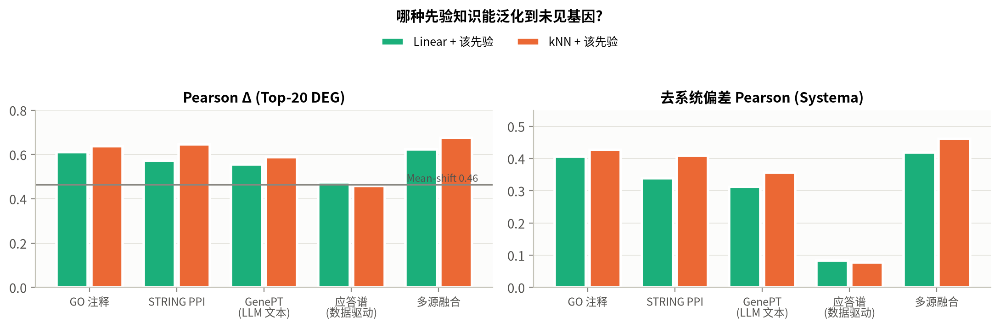
*图 4 单一先验与多源融合*

| 消融（相对完整模型） | Δ 去偏 Pearson | Δ Top-20 DEG Pearson |
|---|---|---|
| 去掉 GO | −0.029 | −0.009 |
| 去掉 GenePT（语言模型） | −0.024 | −0.005 |
| 自由注意力（不用知识核） | −0.021 | −0.016 |
| 去掉 STRING PPI | −0.020 | −0.006 |
| 拼接代替 Transformer 融合 | −0.009 | −0.002 |
| 去掉应答谱 | −0.006 | +0.003 |
| 去掉 top-k 稀疏 | −0.003 | 0.000 |
| 去掉方向损失 | −0.003 | 0.000 |
| 去掉 CRISPRi 敲低规则 | −0.011 | **−0.072** |

三点发现：（1）三种外部知识互补，去掉任何一种都显著下降；（2）"知识核"是关键设计，把注意力换成从零学习的投影会下降 0.021，说明在约 870 个训练样本下，以多源 kNN 为起点只学修正量是必要的；（3）敲低规则对 Top-20 DEG 指标贡献最大，因为在 412 个靶基因被测量的扰动中，靶基因本身在 94.9% 的情况下就是排名第一的 DEG。

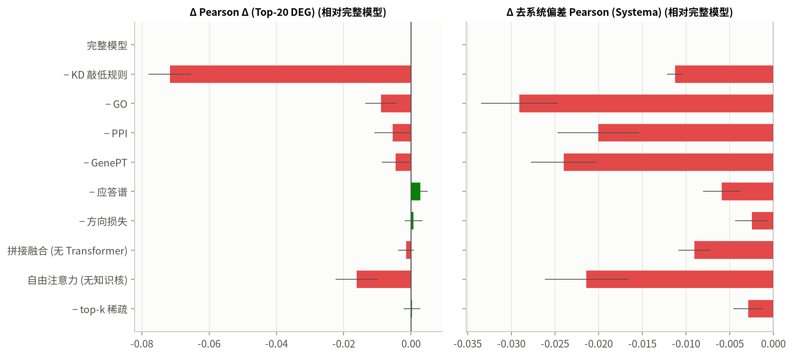
*图 5 消融实验*

### 5.3 按效应强度分层

把扰动按 DEG 数分成三组（弱：3–152；中：153–577；强：578–3045 个 DEG），PerturbFormer 的去偏 Pearson 分别为 0.35 / 0.45 / 0.64，在三组中都领先线性基线（0.31 / 0.39 / 0.59）。弱效应扰动的信号接近噪声水平，是所有方法共同的难点（`fig6_strata.png`）。

### 5.4 单细胞生成：条件流匹配（高级版本）

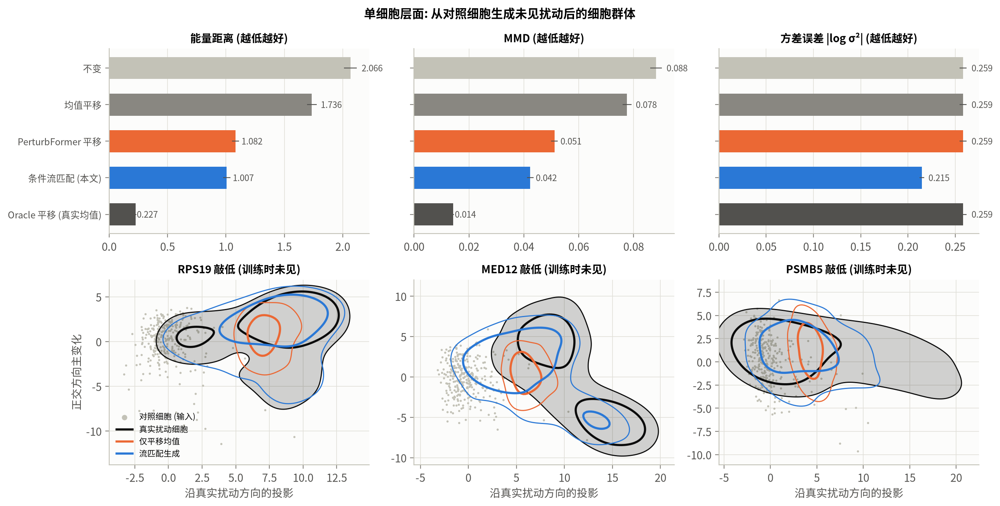
*图 6 条件流匹配生成的未见扰动细胞群体*

对全部 1,092 个未见扰动，用同一批 300 个对照细胞作为输入，比较生成的细胞群与真实扰动细胞（PCA 100 维空间，`fig7_flow.png`）。**PCA 坐标系在每一折只用对照细胞和训练扰动的细胞拟合**，测试扰动的细胞既不参与流模型训练，也不参与构建潜空间。

除了只移动均值的基线，这里还加入一个更强的、不需要训练的单细胞基线——**借用相似扰动的细胞**：取先验知识上最相似的 5 个已测扰动，把它们的真实细胞各自减去均值后合并，再加上 PerturbFormer 预测的平均变化。它直接复制了相关扰动真实的细胞间差异。

| 方法 | 能量距离 ↓ | MMD ↓ | 方差误差 \|log σ²\| ↓ |
|---|---|---|---|
| 不变（对照细胞） | 2.065 | 0.088 | 0.260 |
| 均值平移 | 1.735 | 0.078 | 0.260 |
| PerturbFormer 平移（只移动均值） | 1.080 | 0.051 | 0.260 |
| 借用相似扰动的细胞 + PerturbFormer 平移 | 0.970 | 0.042 | 0.217 |
| **条件流匹配（本文）** | **1.007** | **0.042** | **0.216** |
| *Oracle 平移（使用真实均值，参考）* | 0.227 | 0.014 | 0.260 |

- **相对只平移均值**：能量距离下降 7%（70% 的扰动更好，配对 Wilcoxon p = 9e-35），MMD 下降 17%（p = 5e-86），方差误差下降 17%（p = 6e-33）。平移不改变方差，而流模型学到了扰动对细胞异质性的影响，例如 MED12 敲低后真实细胞呈双峰，流匹配部分复现了第二个峰。
- **相对借用细胞：持平。** 平均能量距离流模型高 4%，但逐个扰动比较只有一半左右（52%）更好或更差，差异不显著（p = 0.6）；MMD 与方差误差同样接近（相对差 +1.3%、-0.4%）。也就是说，**在分布指标上，学到的流模型并没有超过"检索相似扰动的真实细胞"这一免训练做法。**流模型不可替代的地方是逐细胞映射：给定一个具体的输入细胞，它给出这个细胞自己的反事实状态（`predict.py --cells`），借用细胞只能给出一个群体。
- **一次失败的改进尝试**：借用细胞的优势来自相似扰动的方差信息，因此尝试把"相似扰动的方差谱"也作为流模型的条件（`05_flow.py --var_cond`）。在开发集上（87 个开发基因，测试折未参与）它反而变差：能量距离 1.090，原版 0.964，借用细胞 0.966（相对原版 p = 4e-03），因此没有采用。
- Oracle 平移的能量距离仅 0.227，远低于所有可实现的方法。**单细胞层面的主要误差来源是对未见基因平均效应的预测，而不是分布形状**；改进伪批量预测仍是第一优先级。
- 解码回基因空间后，生成细胞的平均值与 PerturbFormer 的伪批量预测基本一致（全基因 Pearson 0.556 vs 0.567），说明流模型没有破坏均值预测。
- 第一版评测中 PCA 用全部扰动的细胞拟合（含测试扰动），修复后结论不变，幅度略小（能量距离降幅 8% → 7%）。

### 5.5 外部验证：Replogle → Adamson（另一实验室）

训练时剔除全部 86 个 Adamson 靶基因，在两数据集共有的 1,910 个基因上评估（`fig8_external.png`）。对 41 个在两个筛选中都被扰动的基因，用"Replogle 中同一基因的实测响应"预测 Adamson，作为跨实验室可重复性上限。

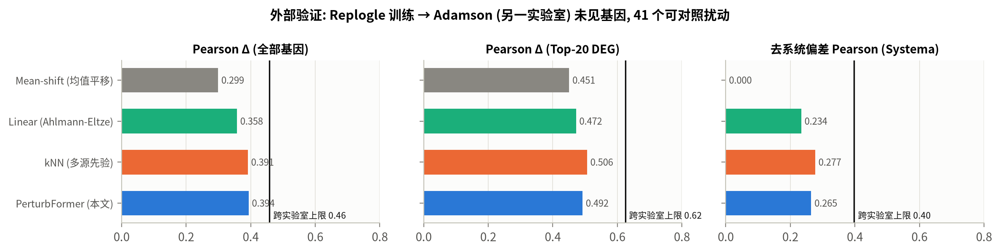
*图 7 跨实验室外部验证*

| 模型（41 个可对照基因） | Pearson 全部基因 | Pearson Top-20 DEG | 去偏 Pearson |
|---|---|---|---|
| 均值平移 | 0.299 | 0.451 | 0.000 |
| Linear +KD | 0.358 | 0.472 | 0.234 |
| kNN 多源 +KD | 0.391 | **0.506** | **0.277** |
| PerturbFormer +KD | **0.394** | 0.492 | 0.265 |
| *Replogle 实测同一基因（跨实验室上限）* | 0.458 | 0.624 | 0.398 |

- 跨实验室差异本身很大：即使直接用另一实验室对同一基因的实测结果，全基因相关也只有 0.46。两种知识检索方法对完全未见的基因达到这一上限的 79–86%（全基因、Top-20 DEG）和约 67–70%（去偏）。
- 在外部数据上，kNN 在 Top-20 DEG 和去偏 Pearson 上略好于 PerturbFormer，PerturbFormer 在全基因 Pearson 和识别排名（全部 86 个扰动：0.339 vs 0.353）上更好。可学习模型在训练数据分布内获得的小幅优势，在跨实验室场景中没有保持下来。
- Adamson 筛选聚焦于内质网应激，所有扰动共享很强的 UPR 系统性响应，均值平移的 DEG 方向准确率（0.75）反而高于所有模型，但它的去偏相关为 0。这再次说明需要同时报告去偏指标。

### 5.6 第二个数据集内部的未见基因评测：Adamson（86 个扰动）

用同样的 5 折未见基因设定在 Adamson 数据集内部训练和评估（`results/adamson/`）：

| 模型 | Pearson 全部基因 | Pearson Top-20 DEG | 去偏 Pearson | DEG 方向准确率 | 识别排名 ↓ |
|---|---|---|---|---|---|
| 均值平移 | 0.754 | 0.799 | 0.000 | 0.892 | 0.500 |
| Linear +KD | 0.812 | 0.930 | 0.476 | 0.942 | 0.194 |
| PerturbNet +KD | 0.813 | 0.910 | 0.474 | 0.945 | 0.228 |
| kNN 多源 +KD | 0.835 | 0.945 | 0.498 | 0.954 | 0.189 |
| **PerturbFormer +KD** | **0.857** | **0.950** | **0.544** | **0.960** | **0.172** |
| *可达上限* | 0.986 | 0.976 | 0.946 | — | — |

在这个更小、更同质（均为内质网应激相关基因）的数据集上，PerturbFormer 在所有指标上最优。相对 kNN，去偏 Pearson +0.045（p = 0.02）、全基因 Pearson +0.022（p = 0.007）、Top-20 DEG Pearson +0.005（p = 8e-4）；方向准确率与识别排名差异不显著。Adamson 的测量信度远高于 K562 全基因组筛选（每个扰动约 500 个细胞），可达上限接近 1；均值平移的全基因相关高达 0.75，反映了 UPR 筛选中极强的共同响应，去偏指标再次揭示它不含扰动特异信息。

### 5.7 DEG 方向预测：错误出在哪里

题目要求预测差异基因的上下调方向。除了 Top-20 DEG 的方向准确率，这里把全部 672,827 个显著 DEG（FDR < 0.05，所有扰动合计）按真实变化幅度 |Δ| 分层（`fig_interp_H_direction.png`）：

| 模型 | 全部显著 DEG | AUROC（上调 vs 下调） | \|Δ\| < 0.05 | 0.05–0.1 | 0.1–0.2 | 0.2–0.5 | > 0.5 |
|---|---|---|---|---|---|---|---|
| PerturbFormer +KD | 0.878 | 0.946 | 0.741 | 0.830 | 0.890 | 0.932 | 0.945 |
| kNN 多源 +KD | 0.877 | 0.946 | 0.731 | 0.827 | 0.889 | 0.934 | 0.950 |
| PerturbNet +KD | 0.870 | 0.939 | 0.756 | 0.820 | 0.878 | 0.927 | 0.949 |
| Linear +KD | 0.857 | 0.930 | 0.707 | 0.809 | 0.868 | 0.915 | 0.938 |
| 均值平移 | 0.739 | 0.811 | 0.462 | 0.663 | 0.759 | 0.831 | 0.876 |

- PerturbFormer 在全部显著 DEG 上的方向准确率为 87.8%（AUROC 0.946），变化幅度大于 0.2 的 DEG 达到 93.2% 以上。**方向错误集中在 |Δ| < 0.05 的弱变化基因**（准确率 74.1%），这些基因的变化接近测量噪声。
- 5.1 中 PerturbNet 的 Top-20 方向准确率最高；从分层结果看，它的优势只出现在最弱的一档（0.756 vs 0.741），在全部显著 DEG 上 PerturbFormer 更高（0.878 vs 0.870）。
- 均值平移在弱变化基因上接近随机（0.462），说明这些基因的方向确实依赖扰动特异的信息。

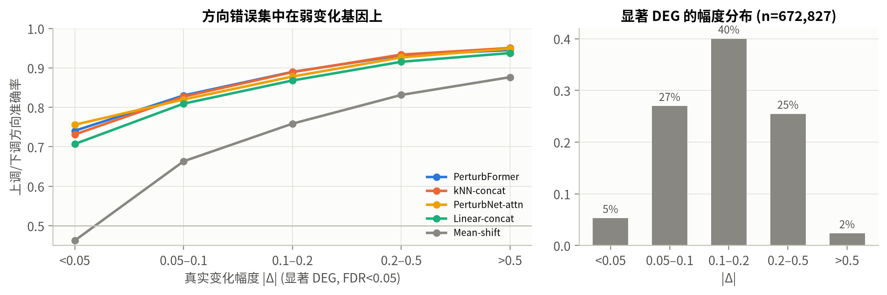
*图 8 DEG 方向准确率按变化幅度分层*

## 6 Biological interpretation：生物学解释

以下分析全部基于 out-of-fold 预测，即每个基因的预测都来自它被完全留出的那一折。

### 6.1 CRISPRi 自检
412 个靶基因在测量范围内的扰动中，靶基因 **100% 显著下调**，残余表达中位数接近 0；94.9% 的扰动中靶基因是排名第一的差异基因。敲低规则预测的靶基因变化与实测的相关 r = 0.973。这说明数据质量可靠，同时解释了为什么一个简单的领域知识规则能大幅提升 Top-20 DEG 指标。

### 6.2 哪些基因可预测？
按功能类别统计去偏 Pearson（`fig_interp_B_classes.png`）：伴侣蛋白 CCT/TRiC（0.83）、胞质核糖体（0.82）、RNA 外切体（0.74）、Mediator（0.73）、蛋白酶体（0.71）最可预测；RNA Pol II / 转录起始（0.47）、未归类基因（0.38）最难。规律很清楚：**同一复合体成员敲低后效应高度一致**，只要有一个成员被测过，其余成员就能被准确预测。也有例外：在 Mediator 和 RNA Pol II 类别上，kNN（0.77、0.57）优于 PerturbFormer（0.73、0.47），说明学到的知识源权重并非处处最优。

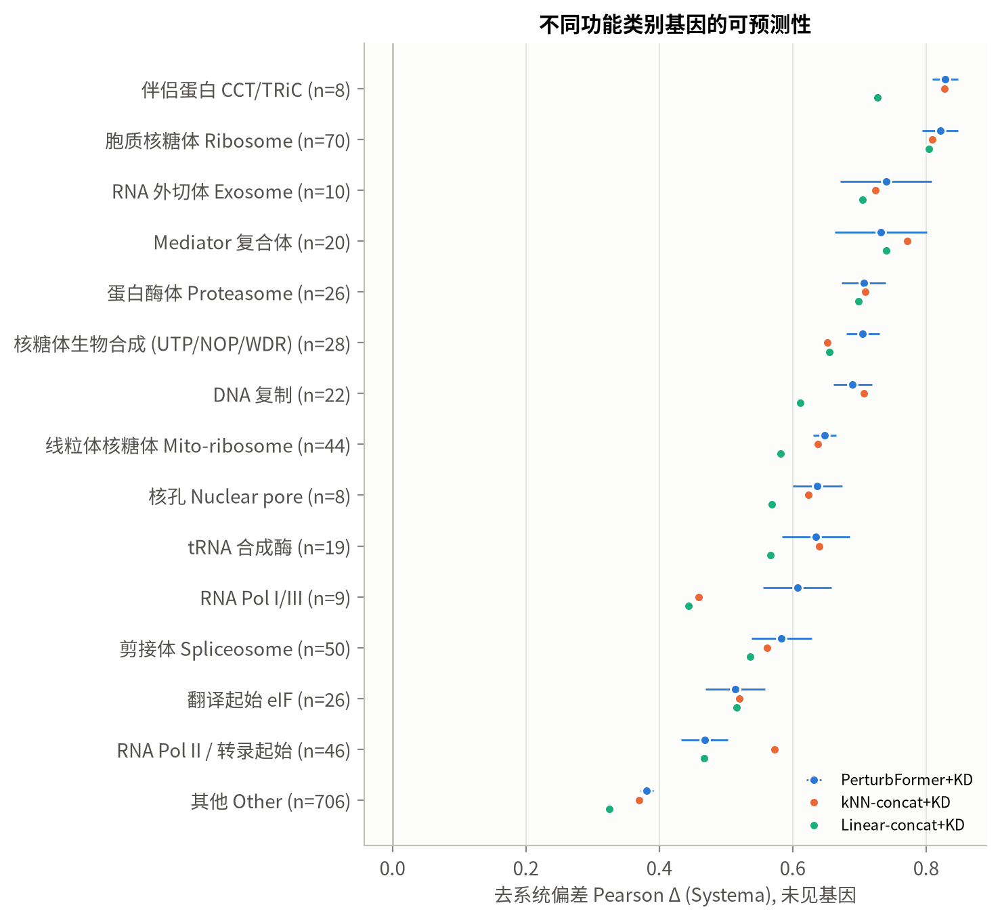
*图 9 不同功能类别基因的可预测性*

### 6.3 复合体结构
以 CORUM 复合体为金标准，计算每个复合体成员基因 Top-5 最相似扰动中同复合体成员的比例（`fig_interp_C_complex.png`）：随机 2.7%；实测应答谱之间 42.7%；先验知识相似度 60.3%；PerturbFormer 注意力检索邻居 56.1%；用预测应答谱去检索实测应答谱 48.6%。实测数据中"同复合体 → 相似响应"的规律真实存在，这是模型能够"借鉴"的生物学基础；预测应答谱也保留了这一结构。

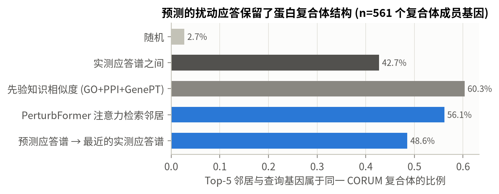
*图 10 预测保留蛋白复合体结构*

### 6.4 通路一致性
对 50 条 MSigDB Hallmark 通路，计算每个扰动的通路平均变化，再比较预测与实测：每条通路跨扰动的平均相关 r = 0.587（kNN 0.579，Linear 0.494，均值平移 −0.057）；对实测变化最大的 25% 通路，方向预测正确率 93.8%。在变化最大的 20 条通路中，DNA 修复（0.74）、氧化磷酸化（0.71）、干扰素 α 应答（0.70）预测最准，MYC 靶基因 V1/V2（0.56/0.58）、mTORC1（0.53）居中（`fig_interp_D_pathways.png`）。

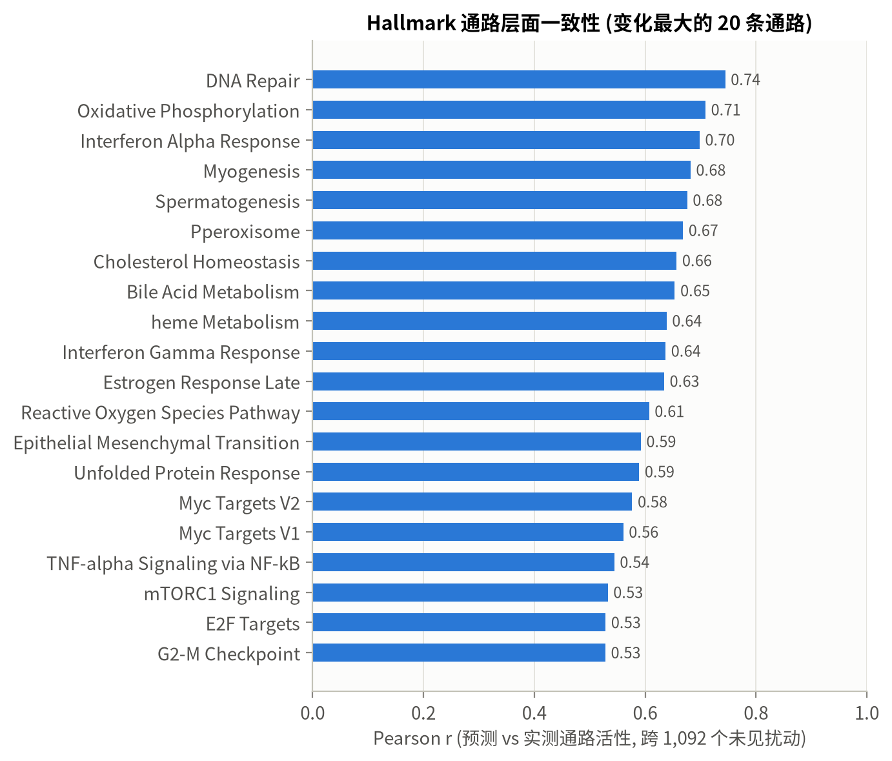
*图 11 Hallmark 通路层面一致性*

### 6.5 案例分析（全部为未见基因）

| 基因 | 功能 | Pearson（全部 / Top-20 DEG） | 模型检索到的已测扰动 | 预测 vs 实测富集 |
|---|---|---|---|---|
| RPS19 | 40S 核糖体蛋白，Diamond-Blackfan 贫血致病基因 | 0.97 / 0.99 | RPS17、RPS16、RPS24、RPS15、RPS14 | 下调：胞质翻译（预测 q=3e-29；实测 q=1e-24） |
| MED12 | Mediator 激酶模块亚基 | 0.91 / 0.98 | C7orf26、MED30、MED17、MED4、MED8 | 下调：MYC 靶基因 V1（预测 q=5e-15；实测 q=5e-20）；上调：血红素代谢（两者均显著） |
| PSMB5 | 20S 蛋白酶体 β5 催化亚基（硼替佐米靶点） | 0.85 / 0.98 | PSMB2、PSMB3、PSMB1、PSMA6、PSMA7 | 下调：MYC 靶基因；上调：EMT、SQSTM1、UBC（蛋白稳态应激） |
| **GATA1**（失败） | 红系主转录因子 | 0.33 / 0.44 | ATF4、MAX、TFDP1、ZBTB17、HSF1 | MYC 靶基因下调预测正确；**"氧运输"（HBG1/HBG2/HBZ）预测上调，实测下调** |

GATA1 是一个有启发的失败。K562 是红白血病细胞系，GATA1 维持其红系身份，敲低后血红蛋白基因下调。训练集中没有效应与 GATA1 相同的基因，模型从 GO/PPI/GenePT 中只能看出"它是一个转录因子"，于是借鉴了 ATF4、MAX 等一般转录因子：共性的 MYC 靶基因下调预测对了，红系特异的部分方向却预测反了。**谱系特异的主调控因子无法靠"相似基因"外推，这正是最需要实验的地方。**

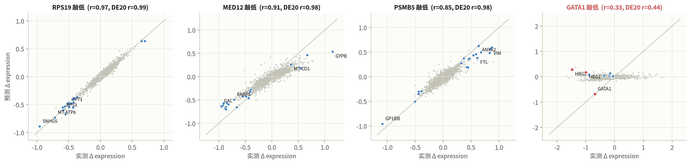
*图 12 案例：三个成功、一个失败（均为未见基因）*

### 6.6 模型如何决策，何时失败
- **知识源权重**（`fig_interp_F_sources.png`）：整体上 GO 权重最高；Mediator 复合体更依赖 PPI（0.41），翻译起始因子更依赖 GenePT（0.31），胞质核糖体则对三种外部知识几乎平均分配（0.30 / 0.29 / 0.30）。模型对不同基因自适应地分配信任。
- **失败模式**（`fig_interp_E_failure.png`）：去偏 Pearson 与"该基因和训练集中最相似基因的先验相似度"的 Spearman ρ = 0.52，与扰动效应强度（DEG 数）的 ρ = 0.49。最差的基因包括 RPL13、RUVBL1、PPRC1、FTSJ3、GATA1；最好的几乎都是核糖体蛋白。
- **可靠性评级**：按先验相似度的三分位数把基因分为低、中、高三档，交叉验证中三档的平均去偏 Pearson 依次为 0.32 / 0.47 / 0.65，Top-20 DEG Pearson 依次为 0.61 / 0.75 / 0.88。这个相似度在预测前就能计算，因此预测工具会对每个查询基因自动给出评级：RPS19 为"高"，MYC 为"中"（最相似的已测扰动是它的结合伙伴 MAX），GATA1 为"低"，与 6.5 中观察到的结果一致。
- **启示**：下一轮实验应优先测知识空间中离已测基因最远的基因（主动学习）。

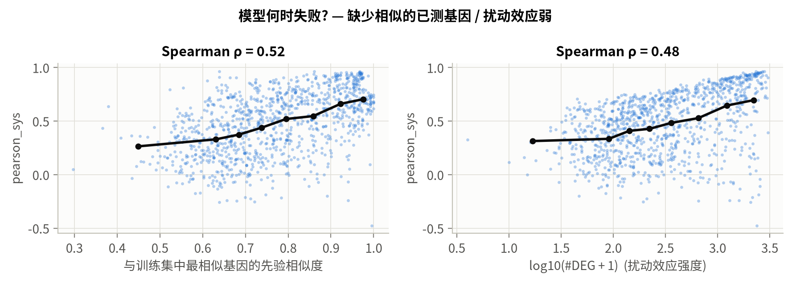
*图 13 失败模式*

## 7 最终成果：虚拟细胞原型

1. **命令行**：`python scripts/predict.py --gene <基因> [--cells 细胞.h5ad]`，输出预测的单细胞表达（h5ad）、伪批量变化表、证据报告（检索到的已测扰动与权重、知识源权重、Hallmark 通路变化；若该基因测过，则在将其移出记忆后与实测比较）和可视化。
2. **Python API**：`VirtualCell.load(...).predict(gene, cells)`。
3. **可靠性评级**：每次预测都附带"高 / 中 / 低"评级及交叉验证中同档基因的平均准确率（见 6.6），提醒使用者哪些预测需要实验确认。
4. **任意基因**：先验嵌入覆盖约 2.1 万个人类基因（GO 88%、STRING 76%、GenePT 91%），包括从未被扰动过的基因。
5. **交互式浏览器** `docs/explorer.html`：浏览全部 1,092 个未见基因的预测与实测对比、检索证据和通路变化。

## 8 讨论

**实验严谨性与可复现性**
- 五折划分用 3 个随机种子重复，结论与模型排序不变（5.1b）。
- **研发过程说明**：开发早期（PerturbFormer 出现之前）曾在完整五折上运行线性、kNN 和 PerturbNet 以调试代码；此后 PerturbFormer 的所有设计比较只在开发集上进行。开发集基因属于第 1–4 折的测试集，因此只有第 0 折的 219 个基因完全没有被设计过程接触。在这一折上，PerturbFormer 相对 kNN 的优势反而更大（去偏 Pearson +0.012，第 1–4 折 +0.005；Top-20 DEG Pearson +0.011，第 1–4 折 −0.007），没有迹象表明设计过程抬高了结果。
- 超参数扫描只在开发集上进行（`dev_sweep.csv`）：10 组配置的 Top-20 DEG Pearson 极差 0.007、去偏 Pearson 极差 0.015（同配置不同种子的标准差约 0.004）。最终使用的是默认配置，并未按开发集最优挑选，结论不依赖调参。
- 所有指标同时报告配对检验、95% bootstrap 置信区间和测量噪声上限。
- 开发过程中发现并修复了两个会影响结论可信度的问题，修复后全部结果重新计算：（1）GO 嵌入在不同进程间不可复现（Python 字符串哈希随机化改变了 GO 术语顺序，进而影响随机化 SVD），已改为确定性排序；（2）Welch t 检验的自由度计算中误加了绝对 ε，低表达基因的 p 值被高估，现已与 `scipy.stats.ttest_ind(equal_var=False)` 逐位一致。
- 第二轮验收又修复了一处轻度数据泄露：流模型最初使用的 PCA 坐标系是用全部扰动（包括每折的测试扰动）的细胞拟合的。现在每一折只用对照细胞和训练扰动的细胞拟合 PCA，单细胞评测全部重做（5.4）。监督模型的评测不涉及 PCA，不受影响。
- 先验知识嵌入（GO TF-IDF、STRING 谱嵌入、GenePT 的 PCA）只使用基因注释、网络和文本，不使用任何表达响应，因此在全部基因上拟合不构成标签泄露；数据驱动的应答谱嵌入在每一折只用训练扰动计算。
- `tests/` 中有 11 个不依赖数据的单元测试：统计函数与 scipy / statsmodels 逐位对照，划分不重叠，以及两项防泄露检查（修改测试扰动的数据后，应答谱嵌入和细胞 PCA 均不变）。GitHub 上每次推送会自动运行。
- 全流程 `run_all.sh` 一键复现，CPU 即可运行。

**局限**
- 只使用一个细胞系（K562）和单基因敲低；外部验证也限于 K562。
- 模型的泛化能力本质上受限于"是否存在功能相似的已测基因"；对谱系特异的调控因子会失败。
- 流模型在 100 维 PCA 潜空间中工作，单细胞层面的基因细节由 PCA 截断限制。
- 先验知识本身存在研究偏倚：研究充分的基因注释更多、预测更准。

**展望**
- 跨细胞系迁移（Replogle RPE1 / HepG2 / Jurkat），把"细胞背景"作为显式输入；
- 组合扰动（Norman 2019），研究遗传相互作用；
- 用预测不确定性与先验新颖度驱动主动学习，选择下一轮最有信息量的实验。

## 参考文献
1. Replogle J.M. et al. Mapping information-rich genotype-phenotype landscapes with genome-scale Perturb-seq. *Cell* 185, 2559–2575 (2022).
2. Adamson B. et al. A multiplexed single-cell CRISPR screening platform enables systematic dissection of the unfolded protein response. *Cell* 167, 1867–1882 (2016).
3. Roohani Y., Huang K., Leskovec J. Predicting transcriptional outcomes of novel multigene perturbations with GEARS. *Nat Biotechnol* 42, 927–935 (2024).
4. Ahlmann-Eltze C., Huber W., Anders S. Deep-learning-based gene perturbation effect prediction does not yet outperform simple linear baselines. *Nat Methods* (2025).
5. Viñas Torné R. et al. Systema: a framework for evaluating genetic perturbation response prediction beyond systematic variation. *Nat Biotechnol* (2025).
6. Lipman Y. et al. Flow matching for generative modeling. *ICLR* (2023).
7. Tong A. et al. Improving and generalizing flow-based generative models with minibatch optimal transport. *TMLR* (2024).
8. Chen Y., Zou J. GenePT: a simple but hard-to-beat foundation model for genes and cells built from ChatGPT. *bioRxiv* (2024).
9. Peidli S. et al. scPerturb: harmonized single-cell perturbation data. *Nat Methods* 21, 531–540 (2024).
10. Bunne C. et al. How to build the virtual cell with artificial intelligence: priorities and opportunities. *Cell* 187, 7045–7063 (2024).
11. Szklarczyk D. et al. The STRING database in 2023. *Nucleic Acids Res* 51, D638–D646 (2023).
12. Tsitsiridis G. et al. CORUM: the comprehensive resource of mammalian protein complexes—2022. *Nucleic Acids Res* 51, D539–D545 (2023).
